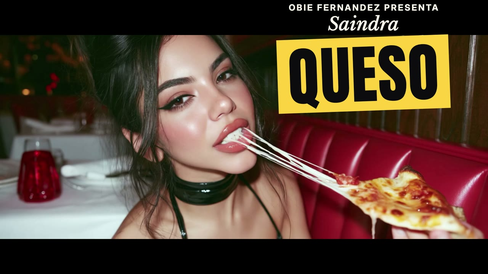
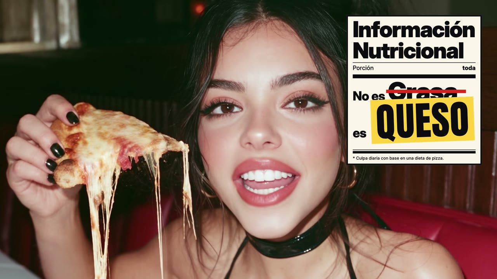
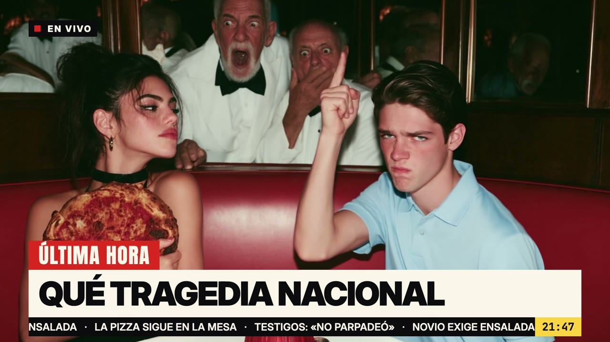
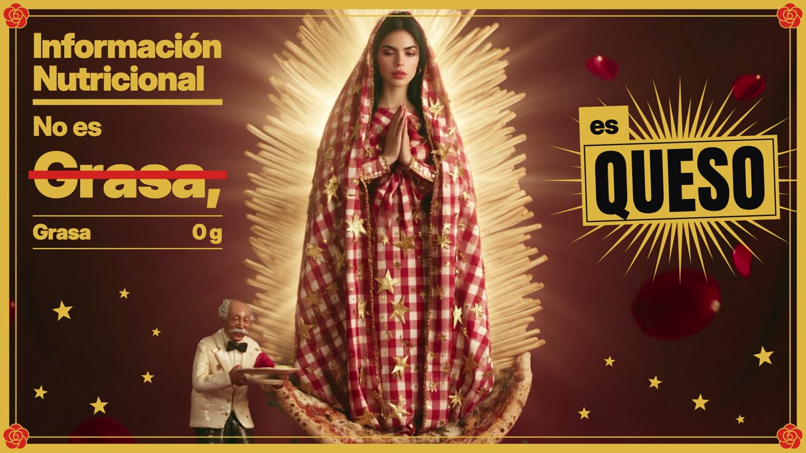

# slopcore

A Claude Code skill and toolkit for making a music video from a song you already have.

The picture is generated: Midjourney stills, turned into video clips by Seedance. Every lyric and graphic is drawn in code on top of the footage, timed to the word and the beat. You bring the song, the lyrics, the look of your artist and your taste. Claude Code runs the pipeline and stops at each step for your approval.



It was built while making ["Queso" by Saindra](https://x.com/obie/status/2106817463388430831): 3 minutes 49 seconds, 93 shots, about 11 hours of agent time across two sittings, and $309 of Seedance. Everything learned on that production is written into the skill, and the whole project is included as a worked example.

| | | |
|---|---|---|
|  |  |  |

## Install

```
/plugin marketplace add obie/slopcore
/plugin install slopcore@slopcore
```

The skill loads at the next session start. Then ask for what you want:

> make a music video for my song. the wav is at ~/Music/track.wav and here are the lyrics

or run `/slopcore:music-video`.

## What is in here

```
skills/music-video/
  SKILL.md              the pipeline, the approval gates and the rules
  references/           one page per phase, plus real costs and a list of what went wrong
  toolkit/tools/        song analysis, Midjourney and Seedance drivers, image fixes, review pages, cover art
  toolkit/engine/       the renderer that draws lyrics and graphics in headless Chromium
  examples/queso/       the finished project: brief, storyboard, all 101 clip prompts, chapter code, word timings
```

Good places to start reading:

- [`SKILL.md`](skills/music-video/SKILL.md) for the method in one page
- [`references/lessons.md`](skills/music-video/references/lessons.md) for every mistake and the rule it produced
- [`references/costs.md`](skills/music-video/references/costs.md) for the bill
- [`examples/queso/PROMPTS.md`](skills/music-video/examples/queso/PROMPTS.md) for every Seedance prompt
- [`toolkit/README.md`](skills/music-video/toolkit/README.md) for the commands

## The pipeline

1. **Song analysis.** A beat grid and a time for every sung word. You confirm the timing by ear.
2. **Concept.** A brief and a design language: every lyric lives on a surface from the world of the song.
3. **Casting test.** Your artist generated several ways. You pick the route.
4. **Storyboard.** One shot per lyric line, every shot a video clip.
5. **Plates.** A still for every shot on a review board. You comment until they are right.
6. **Prompt book and pilot.** Every clip prompt written by hand, then three test clips.
7. **Main clip run.** In batches, after you say go on a stated cost.
8. **Chapters.** Parallel agents draw the lyrics and graphics for each section. You get a rough cut.
9. **Finishing.** Opening frame, title, credits, watermark, audio master, cover art.

## What you need

- Claude Code
- A Midjourney subscription, signed in to Chrome with remote debugging turned on
- A Higgsfield API key with a balance, for Seedance 2.5
- An OpenRouter key, for image fixes
- A Mac with Apple Silicon. The transcription step uses `mlx-whisper`; other machines need a different Whisper build.
- Python 3.11, Node 22, ffmpeg, ImageMagick, `cloudflared`

Budget $300 to $450 of video generation for a four-minute song with one shot per lyric line.

## Limits

- The toolkit was written for one production on one machine and then cleaned up for release. Expect to adapt it.
- Midjourney is driven through your own browser session. Their web interface changes, and `mj.mjs` will need care when it does.
- Seedance prices and discounts change. Read your billing page for the real figure.
- The video model refuses some pictures. The skill explains what to do when it does.

## Credits

The method follows the one [anabology](https://x.com/anabology/status/2106473469441384788) published in the making-of packages for their videos BLISS and CLODYSSEY. Those packages are the reason this exists.

## Licence

The code and documentation are MIT licensed. See `LICENSE`.

The material in `skills/music-video/examples/queso/` that belongs to the song (the lyrics, the stills, the cover art and the artist's likeness) is copyright 2026 Obie Fernandez, all rights reserved. It is included so you can study a finished project. See the notice in that folder.

Fonts are under the SIL Open Font License. Their licence files sit beside them.
