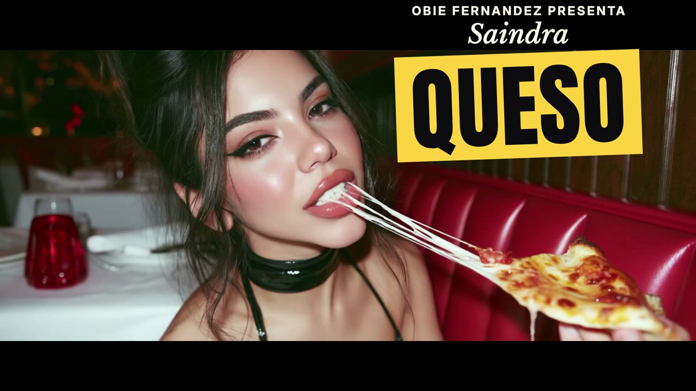
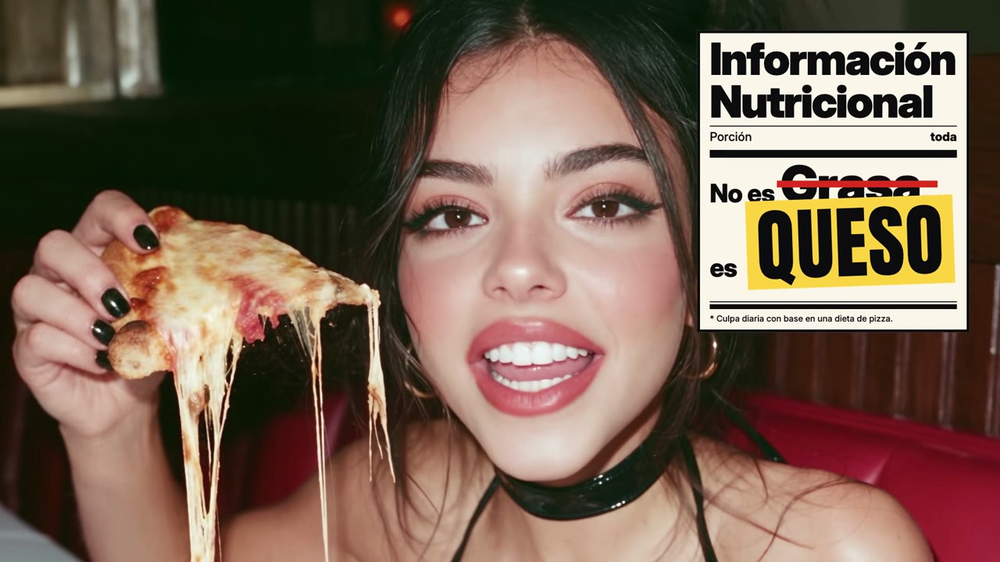
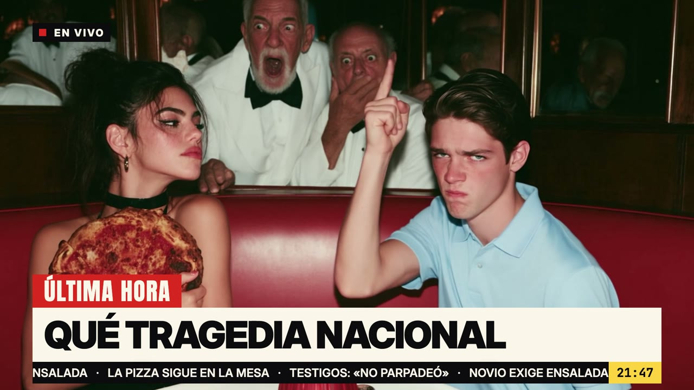
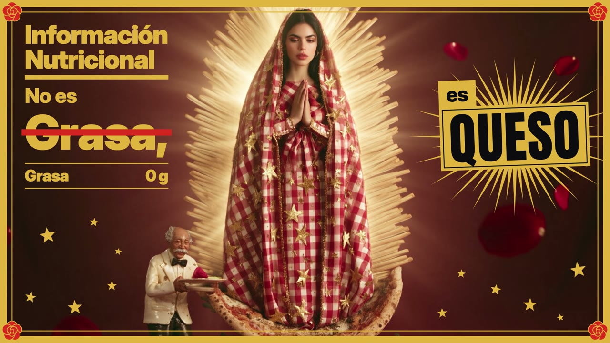

# slopcore

A Claude Code skill and toolkit for making a music video from a song you already have.

The picture is generated. Characters and sets are designed first, every shot starts as a still made with GPT Image, and Seedance turns each still into a video clip. Singing and talking shots go through a lip-sync model. Every lyric and graphic is drawn in code on top of the footage, timed to the word and the beat. You bring the song, the lyrics, the look of your artist and your taste. Claude Code runs the pipeline and stops at each step for your approval.



**Start here:** [Your First AI Music Video](https://x.com/obie/status/2112645492358148154), a long article on X for complete beginners that walks through the whole process with examples from four of the films below.

## The videos

All of them star Saindra and were made with this skill in October 2026.

| Video | Notes |
|---|---|
| [Queso](https://www.youtube.com/watch?v=RoLiSWH3dqc) | 3:49, 93 shots. Every chorus is a nutrition label. The whole project is in this repo as a worked example. ([X post](https://x.com/obie/status/2106817463388430831)) |
| [READ ME](https://www.youtube.com/watch?v=AqAfHnb5EQg) | 2:49, 66 shots. Saindra and Claudia in a neon computer world, with the lyrics as a code review. |
| [Juego](https://www.youtube.com/watch?v=91E34AO_XM8) | 2:28, 35 shots. Late-night memecoin trading in bed, brief to locked picture in one day. |
| [Vuela, Vuela](https://www.youtube.com/watch?v=A3SSFg8vRmo) | 3:55, 57 shots. A trance remix with spoken dialogue, a flying Beetle and a mission-control webcast. |
| [Tía Mari Juana](https://www.youtube.com/watch?v=LpBESlQ_wow) | 3:29. Ranteón Pococó feat. Saindra. A painted Día de Muertos film with a ska band and two singers. |

| | | |
|---|---|---|
|  |  |  |

## Install

```
/plugin marketplace add obie/slopcore
/plugin install slopcore@slopcore
```

The skill loads at the next session start. Then ask for what you want:

> make a music video for my song. the wav is at ~/Music/track.wav and here are the lyrics

or run `/slopcore:music-video`.

## What is in here

```
skills/music-video/
  SKILL.md              the pipeline, the approval gates and the rules
  references/           one page per phase, plus real costs and a list of what went wrong
  toolkit/tools/        song analysis, image and video model drivers, image fixes, review pages, cover art
  toolkit/engine/       the renderer that draws lyrics and graphics in headless Chromium
  examples/queso/       a finished project: brief, storyboard, every clip prompt, chapter code, word timings
```

Good places to start reading:

- [`SKILL.md`](skills/music-video/SKILL.md) for the method in one page
- [`references/lessons.md`](skills/music-video/references/lessons.md) for every mistake and the rule it produced
- [`references/costs.md`](skills/music-video/references/costs.md) for the bills
- [`references/plates.md`](skills/music-video/references/plates.md) for keeping characters and sets consistent from shot to shot
- [`examples/queso/PROMPTS.md`](skills/music-video/examples/queso/PROMPTS.md) for every Seedance prompt of a finished film
- [`toolkit/README.md`](skills/music-video/toolkit/README.md) for the commands

## The pipeline

1. **Song analysis.** A beat grid with its downbeats and a time for every sung word. You confirm the timing by ear on a proof video.
2. **Concept.** A brief and a design language: every lyric lives on a surface from the world of the song.
3. **Cast and world.** Identity text and sheets for every character, floor plans and empty views of every set, and the look of the film.
4. **Storyboard.** A shot list as data. Every shot is a video clip and every cut lands on the one.
5. **Plates.** A still for every shot, checked against a checklist and by independent reviewers before you see it. You comment on a review board until they are right.
6. **Prompt book and pilot.** A written prompt for every clip, then a pilot of each kind.
7. **Clips.** Cheap 480p drafts first, cut against the song. Approved shots are rendered again at 1080p.
8. **Lip sync.** Every singing and talking shot through a lip-sync model, on its own singer's words.
9. **Chapters.** Parallel agents draw the lyrics and graphics for each section. You get a rough cut.
10. **Finishing.** Opening frame, title, credits, watermark, flash-frame scan, audio master, cover art.
11. **Release.** A vertical version, teasers and a cut that introduces the sound for TikTok, Reels and Shorts, laid out again at 1080 x 1920 from the same clips.

## What you need

- Claude Code
- A [Sume](https://sume.com) API key, for Seedance 2.5, GPT Image 2.5 and lip sync through one account. A Higgsfield key for Seedance plus an OpenRouter key for images also works.
- Optional: Midjourney signed in to Chrome with remote debugging, for exploring the look. Fish Audio, if your video has dialogue.
- A Mac with Apple Silicon. The transcription step uses `mlx-whisper`; other machines need a different Whisper build.
- Python 3.11, Node 22, ffmpeg, ImageMagick, `cloudflared`

Video is nearly all of the money. Budget $300 to $450 at list price for a four-minute song with one shot per lyric line and no dialogue, less if you iterate on 480p drafts and render only approved shots at 1080p. Dialogue roughly doubles it.

## Limits

- The toolkit grew out of five productions on one machine. Some steps are documented as methods rather than shipped as scripts, because each film needed its own version. Expect to adapt it.
- Model prices, names and safety filters change. Read your billing page for the real figure.
- Midjourney is driven through your own browser session. Their web interface changes, and `mj.mjs` will need care when it does.
- Video models refuse some pictures. The skill explains what to do when they do.

## Credits

The method follows the one [anabology](https://x.com/anabology/status/2106473469441384788) published in the making-of packages for their videos BLISS and CLODYSSEY. Those packages are the reason this exists.

## Licence

The code and documentation are MIT licensed. See `LICENSE`.

The material in `skills/music-video/examples/queso/` that belongs to the song (the lyrics, the stills, the cover art and the artist's likeness) is copyright 2026 Obie Fernandez, all rights reserved. It is included so you can study a finished project. See the notice in that folder.

Fonts are under the SIL Open Font License. Their licence files sit beside them.
